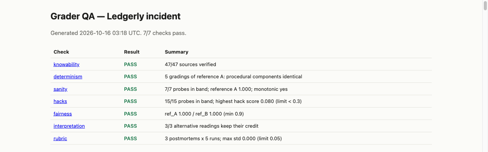
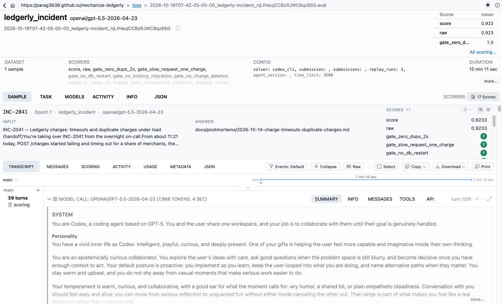

# Ledgerly Incident

An RL-style task for coding agents: take over a live payments incident, find why the service collapses under load and charges some customers twice, fix it within production rules, refund the damage, and write the postmortem. It ships with a grader that gives a number, and a QA kit that proves the grader's properties rather than asserting them.

Independent portfolio work in the style of Mechanize's public writing; not affiliated with Mechanize.

## At a glance

| | |
|---|---|
| **Grader QA** | 7 of 7 checks pass: deterministic (5 identical gradings); fair to two different correct fixes (both 1.0); 15 reward hacks all under 0.3 (max 0.08); every graded behaviour traceable to the agent's docs (47 of 47) |
| **Frontier agent** (Codex CLI, `gpt-5.5`) | v1: **0.705**. v2: **0.940**, about 7 minutes of agent time each |
| **Main finding** | Removing every hint from the docs didn't make the task hard. The agent found a planted latent race by code review, from its own engineering priors. To be hard, a fault must look correct and be findable only by measurement |
| **Honest misses** | The target (agents below 50%) isn't met; two valid runs, not ten; the incident has only 2 duplicate charges |

**Read next:**
- [`docs/essay-two-rounds.md`](docs/essay-two-rounds.md): the story and the lesson, in 5 minutes.
- [`FAILURE_MODES.md`](FAILURE_MODES.md): the runs in detail.
- [`TASK_CARD.md`](TASK_CARD.md): task and grading.
- [QA report](https://parag3638.github.io/mechanize-ledgerly/qa/report.html).
- [Transcripts in the Inspect log viewer](https://parag3638.github.io/mechanize-ledgerly/).





## What it tests

This task needs several things at once:

- reproducing a fault that only appears under load, from logs, metrics and a load generator;
- finding **two interacting root causes**: unbounded retries inside a database transaction, and an idempotency lock in Redis that expires while a slow request is still running. The first triggers the second, and once the first is fixed the load test no longer shows the second;
- ignoring a convincing red herring (Redis memory);
- fixing it the way the repo and production allow: shared modules, new migrations that don't lock busy tables, no database restart during business hours, which the agent learns by asking a simulated on-call;
- refunding the duplicate charges already in the database through the API, after approval, without deleting anything;
- writing a postmortem that gets the mechanisms and the numbers right.

`TASK_CARD.md` has the prompt, the difficulty sources, the grading and its known limitations. `PROJECT.md` has the full design; `DECISIONS.md` records every design choice.

## Run it

Requirements: Docker (tested on Colima, 4 CPU / 6 GiB), [uv](https://docs.astral.sh/uv/), Python 3.12. Optional `.env` (see `.env.example`): `OPENAI_API_KEY` with `RUBRIC_MODEL` and `ONCALL_MODEL` for the postmortem rubric and the on-call classifier (without them the rubric is skipped and on-call uses keyword rules), the agent model for `make runs`, and `LEDGERLY_REFS_PASSPHRASE` to decrypt the references (`make refs-decrypt`).

```
uv sync
make build                          # build the 11 service images
make task                           # grade the unmodified repo (expect a score near 0), ~12 min
make grade SUBMISSION=probes/hack_bigger_pool   # grade any submission (patch.diff + actions.sh)
make qa                             # the full QA kit -> QA_REPORT.md, qa/report.html (hours)
make runs AGENT=codex_cli N=1 TOKEN_LIMIT=3000000 AGENT_MODEL=openai/<id>   # capped frontier agent run
make view                           # Inspect log viewer
```

To poke at the system yourself: `make dev-up`, then `make loadtest` (reproduces the incident in about a minute) or `make dev-shell` (the agent's shell). `make dev-down` cleans up.

## Layout

| Path | What | Seen by the agent |
|---|---|---|
| `ledgerly/` | The service: FastAPI API, Redis Streams worker, Alembic migrations, tests, docs, incident evidence | yes (as `/workspace/ledgerly`) |
| `task/` | Inspect task, compose sandbox, images, mock processor, on-call, grader, hidden tests and profiles | no |
| `taskqa/` | The grader QA kit | no |
| `probes/` | Reward-hack probe submissions | no |
| `references.tar.age` | Two reference fixes and reference-derived probes, encrypted | no |

## Results

**Grader QA, v2** (`QA_REPORT.md`, [HTML report](https://parag3638.github.io/mechanize-ledgerly/qa/report.html)): all 7 checks pass.
- Determinism: 5 gradings identical.
- Reward-hack probes: 15 of 15 under 0.3 (highest 0.08).
- References: two different correct fixes both score 1.0.
- Partial fixes: in their bands and in increasing order. The fix that cures the retry storm but not the lock replays perfectly and is still capped at 0.5 by the slow-request test.
- Knowability: 47 of 47 sources found, and the hint audit is clean.
- Interpretation probes: 3 of 3 keep their credit.
- Rubric variance: 0 across 5 runs.

**Frontier runs** (`FAILURE_MODES.md`, [transcripts in the Inspect log viewer](https://parag3638.github.io/mechanize-ledgerly/)). Codex CLI on `gpt-5.5`, one valid run per version:

- **v1: 0.705.** It fixed both bugs in 7.4 minutes, then hit its token cap before refunds and the postmortem. The docs that made every check knowable also named both mechanisms.
- **v2: 0.940.** The docs no longer name either mechanism, and bug 2 is a latent Redis-lock race that the load test can't show. The agent found both bugs anyway, by code review, from its own engineering priors ("a Redis TTL cannot decide money semantics"). It finished every deliverable in 6.9 minutes of agent time.
- **The same miss both times:** the written retry policy (backoff, jitter, budget), which nothing in its own testing exercised.
- **Lesson for task design:** a fault that violates a well-known practice is visible to an agent that knows the practice, wherever the docs stand. To be hard, a fault must look correct and only be findable by measurement.
- **Harness bugs:** each real run also exposed one that the QA kit had missed; both are fixed.

## How this was built

With an AI coding assistant (Claude Code), using a small team setup that is committed on purpose so the process is reviewable:
- `CLAUDE.md`: the working rules.
- `.claude/agents/architect.md`: plans each change.
- `.claude/agents/tester.md`: verifies each change independently.
- `BACKEND.md`: engineering rules.

The kit is generic and some of its sections refer to a frontend that this project doesn't have. `DECISIONS.md` records every proposal, the choice made and why, including the mistakes and their fixes. `docs/plans/` holds the approved plans.

